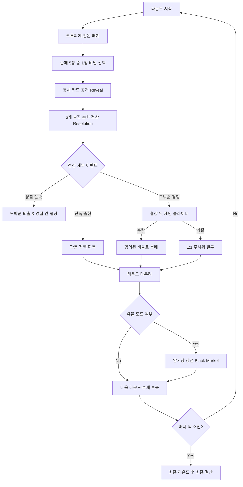

# 📋 GAME DESIGN DOCUMENT (GDD) — 게임 상세 기획서

> **상위 문서:** [`docs/README.md`](../README.md)  
> **관련 문서:** [`docs/game-design/GAME_RULES.md`](GAME_RULES.md), [`docs/game-design/GAME_SYSTEMS.md`](GAME_SYSTEMS.md), [`docs/technical/PROJECT_ARCHITECTURE.md`](../technical/PROJECT_ARCHITECTURE.md)

---

## 1. 개요 및 핵심 루프 (Core Game Loop)

RAZZIA는 **머니 카드 덱이 모두 소진될 때까지 여러 라운드를 진행하여 최종적으로 가장 많은 돈을 획득한 플레이어가 승리**하는 게임입니다.

### 핵심 루프 흐름도

---

## 2. 게임 상태 머신 (Game State Machine)

엔진(`engine/engine.gd`)은 다음과 같은 명확한 상태 열거형(`Phase`)을 기반으로 전이됩니다.

| Phase (상태) | 설명 | 트리거 액션 |
|---|---|---|
| `SETUP` | 플레이어 수(3~8인), 모드(Classic/Relic), 시드 설정 및 덱 셔플 | `START_GAME` |
| `ROUND_START` | 현재 크루피에 지정, 7장의 머니 카드를 6개 바에 배치 (7번째 카드는 선택) | `CROUPIER_PLACE_EXTRA` |
| `CARD_SELECTION` | 모든 플레이어가 5장 손패 중 1장을 비공개 선택 | `CHOOSE_CARD` |
| `REVEAL` | 모든 플레이어의 선택 카드를 테이블에 동시 공개 | 엔진 내부 전이 |
| `RESOLVING_BARS` | 1번 바(Colibri)부터 6번 바(Jazz House)까지 순차 정산 | 엔진 내부 전이 |
| `NEGOTIATION` | 동일 바에 복수의 적격 청구자가 존재할 때 협상 제안 | `MAKE_PROPOSAL` |
| `PROPOSAL_RESPONSE` | 제안을 받은 상대방이 수락 또는 거절 결정 | `ACCEPT_PROPOSAL` / `REJECT_PROPOSAL` |
| `DUEL` | 제안 거절 시 6면체 주사위를 굴려 승자 판정 | `ROLL_DICE` |
| `ROUND_CLEANUP` | 사용된 카드 버림패로 이동, 플레이어별 1장씩 보충하여 5장 유지 | 엔진 내부 전이 |
| `BLACK_MARKET` | (유물 모드 전용) 라운드 종료 후 유물 구매 및 새로고침 | `BUY_RELIC`, `REROLL_SHOP`, `LEAVE_SHOP` |
| `GAME_END` | 머니 덱 소진 후 마지막 라운드 종료, 최종 승자 및 랭킹 산출 | 최종 결산 화면 표시 |

---

## 3. 구성 요소 및 데이터 명세

### 3.1 6대 비밀 주점 (Venues)
각 술집은 고유의 테마 색상과 식별자를 가집니다.
1. `COLIBRI` (블루, `#2f6fb0`): 고급 살롱
2. `COTTON_CLUB` (레드, `#b23a3a`): 할렘의 유명 재즈 클럽
3. `HAVANA_BAR` (골드, `#c9a431`): 쿠바산 럼 전문 바
4. `THE_JUNGLE` (에메랄드 그린, `#2f9e55`): 거친 뒷골목 바
5. `LINCOLNS` (퍼플, `#8a4fb0`): 정재계 거물들의 아지트
6. `JAZZ_HOUSE` (오렌지, `#d9731f`): 뜨거운 라이브 재즈 하우스

### 3.2 플레이어 카드
총 72장의 카드(4~6인 기준 18장 제외 시 54장)로 구성됩니다:
- **도박꾼 카드 (`ZOCKER`):** 6개 바 × 주사위 눈(1~6). 해당 바의 판돈을 획득하기 위해 출현.
- **경찰 단속 카드 (`RAZZIA`):** 6개 바 × 주사위 눈(1~6). 도박꾼들을 급습하여 판돈을 압류.

### 3.3 머니 카드 (총 84장)
| 권종 | 장수 | 총액 |
|---:|---:|---:|
| $5,000 | 15장 | $75,000 |
| $10,000 | 15장 | $150,000 |
| $15,000 | 12장 | $180,000 |
| $20,000 | 12장 | $240,000 |
| $25,000 | 9장 | $225,000 |
| $30,000 | 9장 | $270,000 |
| $40,000 | 6장 | $240,000 |
| $50,000 | 6장 | $300,000 |
| **합계** | **84장** | **$1,480,000** |

---

## 4. 핵심 판정 및 분배 규칙

### 4.1 단독 출현 (Sole Claimant)
특정 바에 단 1명의 ZOCKER만 출현한 경우:
- 해당 플레이어가 해당 바의 모든 판돈을 전액 수령합니다. 바의 남은 판돈은 $0이 됩니다.

### 4.2 경찰 단속 발동 (Razzia Trigger)
- **도박꾼 + 경찰 동시 출현:** 경찰 단속이 성공합니다. 모든 도박꾼은 즉시 퇴출당하여 $0을 받으며, 경찰 카드를 낸 플레이어들이 청구자가 되어 협상/결투를 진행합니다.
- **경찰만 출현 (도박꾼 없음):** 단속할 대상이 없으므로 경찰은 빈손으로 돌아갑니다. **판돈은 압류되지 않고 다음 라운드로 누적됩니다.**

### 4.3 2인 협상 및 결투 시스템
1. **우선권:** 카드에 적힌 주사위 눈(`dieSymbol`)이 더 높은 플레이어가 **제안자(Proposer)**가 됩니다. (동점 시 크루피에로부터 시계방향으로 더 먼 플레이어가 우선)
2. **제안:** 제안자는 바의 총 판돈 중 상대방에게 건넬 금액을 $5,000 단위로 제안합니다.
3. **응답:** 상대방은 수락하거나 거절할 수 있습니다.
   - **수락 시:** 제안된 금액대로 각각 돈을 나누어 갖습니다.
   - **거절 시:** 즉시 1:1 주사위 결투가 발동합니다.
4. **결투 계산식:**
   $$\text{최종 점수} = \text{카드의 주사위 눈(1~6)} + \text{실제 굴린 6면체 주사위 눈(1~6)}$$
   - 최종 점수가 더 높은 자가 바의 **모든 판돈을 독식**합니다.
   - **동점 룰:** 결투를 신청한 도전자(상대방)가 승리합니다.

### 4.4 3인 이상 협상 및 토너먼트 결투
- 3인 청구 시 최고 우선권자가 나머지 2명에게 각각 금액을 제안합니다.
  - 둘 다 수락: 제안대로 3인 분배 완료.
  - 1명 거절: 수락한 1명에게 제안금을 지급하고, 남은 2명이 나머지 판돈을 걸고 결투.
  - 둘 다 거절: 최저 눈과 최고 눈이 먼저 결투 후, 승자가 중간 눈과 최종 결투하여 독식.
- 4인 이상 청구 시 순차 역순 토너먼트 결투가 적용됩니다.

---

## 5. 로그라이크 유물 모드 (Relic Mode / Roguelike Variant)

원작의 클래식 룰 위에 덱빌딩 및 시너지 재미를 부여한 공식 변형 모드입니다.

### 5.1 스타터 유물 드래프트 (Round 1 시작 전)
게임 시작 시 3개의 유물 중 1개를 무료로 선택합니다:
1. `lucky_coin` (결투형): 결투 최종 점수 +1 영구 보너스.
2. `protection_racket` (경제형): 바를 단독으로 독점 시 +$5,000 보너스 현금 지급.
3. `informant` (정보형): 카드 선택 전 AI 1명의 목표 바를 사전 탐지.

### 5.2 라운드 간 암시장 상점 (Black Market)
매 라운드 정산 종료 후 암시장 패널이 열립니다:
- 미보유 유물 8종 중 최대 4종이 무작위 출현.
- 획득한 상금으로 유물을 구매하거나, $5,000를 지불하여 매물을 새로고침(Reroll) 가능.
- **불변식 보존(INV-002):** 상점에서 소비된 금액은 `blackMarketVault`에 적립되어 게임 전체의 총 통화량 불변식을 엄격히 만족합니다.

### 5.3 유물 8종 전체 명세
| ID | 명칭 | 유형 | 가격 | 상세 효과 |
|---|---|---|---:|---|
| `lucky_coin` | 행운의 동전 | 결투 | $25,000 | 모든 결투 시 최종 합산 점수에 +1 보너스 |
| `protection_racket` | 보호세 수금원 | 경제 | $30,000 | 혼자서 바를 독점 정산할 때마다 보너스 +$5,000 지급 |
| `informant` | 비밀 정보원 | 정보 | $20,000 | 카드 선택 단계에서 무작위 AI 1명의 목적지 바를 미리 표시 |
| `swiss_account` | 스위스 비밀계좌 | 경제 | $40,000 | 라운드 종료 시 보유 현금의 10%를 이자로 수령 (최대 $12,000) |
| `bribed_judge` | 매수한 판사 | 결투 | $35,000 | 결투 방어 시 동점이 나오면 도전자가 아닌 본인이 승리 |
| `loaded_dice` | 조작된 주사위 | 결투 | $30,000 | 결투 주사위 굴림 시 1 또는 2가 나오면 최소 3으로 보정 |
| `dirty_cop` | 부패한 경관 | 특수 | $25,000 | 도박꾼이 없어 실패한 단속 카드 플레이 시 바 판돈의 15%를 뇌물로 강탈 |
| `syndicate_crest` | 신디케이트 문장 | 시너지 | $35,000 | 매 라운드 시작 시 보유한 유물 개수당 +$3,000의 배당금 획득 |
