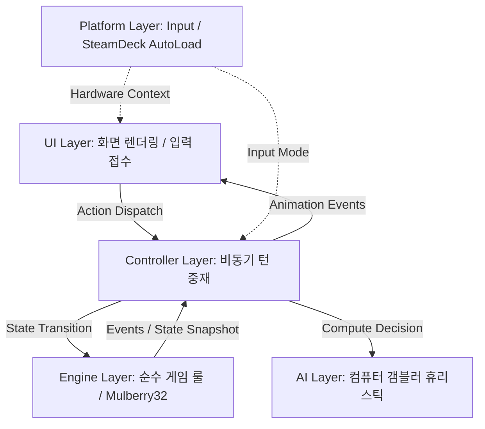

# 🏛️ PROJECT ARCHITECTURE — 소프트웨어 아키텍처 및 계층 설계

> **상위 문서:** [`docs/README.md`](../README.md)  
> **관련 문서:** [`docs/technical/CODE_GUIDELINES.md`](CODE_GUIDELINES.md), [`docs/technical/DATA_AND_SAVE_SYSTEM.md`](DATA_AND_SAVE_SYSTEM.md)

---

## 1. 아키텍처 핵심 원칙: 엄격한 단방향 계층 분리

RAZZIA는 유지보수성과 테스트 용이성을 극대화하기 위해 **엄격한 단방향 의존성(Strict Unidirectional Layering)**을 준수합니다.



### 계층별 의존성 규칙:
1. **`engine/` (순수 룰 계층):**
   - 어떠한 Godot 노드(Node), 씬, 렌더링, 오디오, UI 코드도 임포트하거나 의존하지 않습니다 (`RefCounted` 기반 순수 GDScript).
   - 오직 상태 딕셔너리(`Dictionary`)를 받아 액션(`Action`)을 적용하고 새 상태를 반환하는 순수 상태 머신입니다.
2. **`ai/` (휴리스틱 계층):**
   - 엔진 상태의 공개된 정보(자신의 손패, 버려진 카드, 공개된 바 판돈 등)만을 관찰하여 의사결정을 반환합니다.
   - 플레이어의 비공개 손패나 선택을 훔쳐보는 부정행위(Cheat)가 아키텍처 수준에서 원천 차단됩니다.
3. **`controller/` (비동기 중재 계층):**
   - 플레이어의 UI 액션과 AI 턴의 지연 시간(타이머), 이벤트 큐를 관리하여 게임 흐름을 부드럽게 이끕니다.
4. **`ui/` (프레젠테이션 계층):**
   - 컨트롤러가 발행하는 이벤트를 수신하여 시각적 애니메이션과 사운드를 재생합니다. **UI는 승패나 금액을 독자적으로 계산하지 않습니다 (RULE-034).**
5. **`platform/` (하드웨어 계층):**
   - 싱글톤 오토로드로 상주하며 입력 장치 전환과 스팀덱 전력 프로파일을 관리합니다.

---

## 2. 단일 씬 아키텍처 (Single Scene Architecture)

본 프로젝트는 수십 개의 `.tscn` 파일을 파편화하지 않고, **유일한 루트 씬인 `ui/main.tscn` 하나만을 사용**합니다.

### 왜 단일 씬인가?
- **코드 기반 컴포넌트 렌더링:** 모든 서브 패널과 위젯(`menu_screen.gd`, `game_screen.gd`, `nego_panel.gd`, `board/*.gd`)은 프로시저럴 순수 GDScript로 인스턴스화됩니다.
- **Git 충돌의 원천 차단:** 씬 파일(XML/YAML 포맷) 병합 충돌을 근본적으로 방지하고, 코드 리뷰를 명확하고 투명하게 유지합니다.
- **메모리 누수 방지:** 화면 전환 시 불필요한 씬 리로드 없이 노드 트리의 가시성(`visible`)과 활성화 상태를 엄격히 제어합니다.

---

## 3. 이벤트 디스패치 파이프라인

모든 게임 내 변화는 정형화된 액션 객체(`Dictionary`)를 통해 전달됩니다:

```gdscript
# 액션 디스패치 표준 형태
var action = {
    "type": "CHOOSE_CARD",
    "playerId": 0,
    "cardId": "zocker_COLIBRI_4"
}
var outcome = Engine.dispatch(current_state, action)
var next_state = outcome["state"]
var events = outcome["events"]
```

컨트롤러는 반환된 `events` 배열을 순회하며 UI 연출 큐(`ui/board/board_replay.gd`)에 애니메이션을 예약합니다:
- `CARD_PLAYED` $\to$ 카드가 테이블로 날아가는 애니메이션
- `CARDS_REVEALED` $\to$ 테이블 카드가 동시에 뒤집히는 연출
- `RAID_TRIGGERED` $\to$ 사이렌 울림 및 경찰 서치라이트 투사
- `DUEL_STARTED` $\to$ 컴팩트 결투 뷰 팝업
- `MONEY_AWARDED` $\to$ 바에서 플레이어 칩 스택으로 현금이 날아가는 연출
